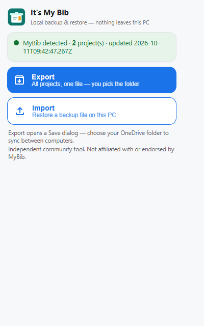
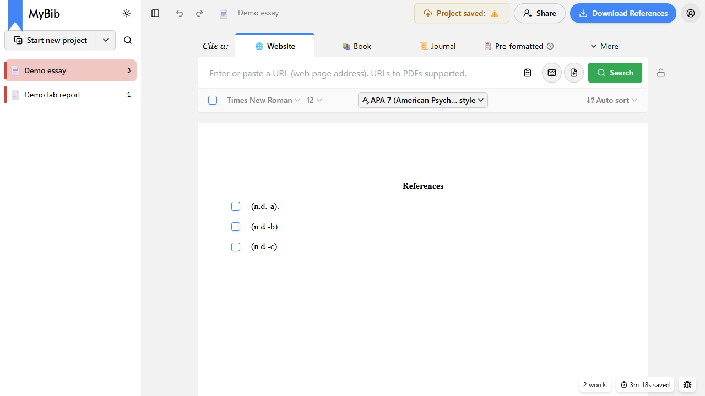
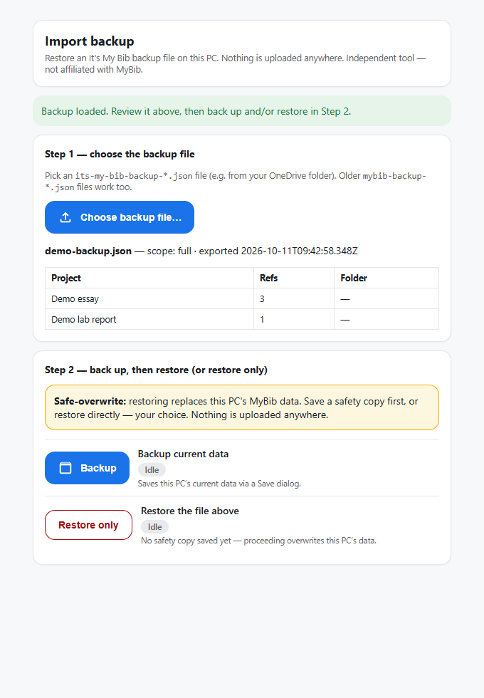

# INSTALL — It's My Bib v1.0.0

Time needed: ~5 minutes. No administrator rights. Files go to your own profile (`%LOCALAPPDATA%\ItsMyBib`).



## What you need

- Windows 10/11 with Microsoft Edge, Google Chrome, Brave or Opera.
- The release ZIP (`ItsMyBib-v1.0.0.zip`), extracted to any folder (e.g. Desktop).
- Your MyBib page open at `https://www.mybib.com/?app`.

> Firefox is not supported in this version (unsigned extensions are discarded on restart; needs Mozilla AMO signing).

## Steps

### 1. Extract the ZIP

Right-click `ItsMyBib-v1.0.0.zip` → **Extract All…**. Inside:

```text
ItsMyBib/
    extension/      the browser extension (do not rename files inside)
    installer/      install.ps1, uninstall.ps1 (+ batch/ fallback)
    docs/           setup screenshots
    README.md  LICENSE  DISCLAIMER.md  INSTALL.md  TROUBLESHOOTING.md  CHANGELOG.md  DEPLOYMENT.md
```

### 2. Run the setup assistant

Open the `installer` folder, right-click **`install.ps1`** → **Run with PowerShell**. If blocked:

```powershell
powershell -ExecutionPolicy Bypass -File ".\installer\install.ps1"
```

Fallback: double-click `installer\batch\install.cmd`.

### 3. Pick browser(s), let it copy

Type e.g. `1` or `A`. The script copies to `%LOCALAPPDATA%\ItsMyBib\extension` and opens the extensions page, with the path in your clipboard.

### 4. One-time browser action

On `edge://extensions` / `chrome://extensions` / `brave://extensions`:

a. Turn ON **Developer mode**. b. Click **Load unpacked**. c. Paste path → **Select Folder**. d. Confirm card **It's My Bib** with no errors.

### 5. Verify

- Open `https://www.mybib.com/?app` (if it was open during install, reload the tab once so the content script loads).



- Click the extension icon: status reads MyBib detected + project count.
- Click **Export**: a Save dialog opens — choose your OneDrive folder. Confirm the file contains `format: mybib-portable-backup`. (The envelope magic string is unchanged from earlier versions so old backup files still restore.)



- Click **Import**: an importer tab opens — choose the backup file, review the project table, then in Step 2 click **Backup** (Save dialog stores this PC's current data; each job shows Idle / Processing / Done / Cancelled / Error) and/or **Restore only**.

## Updating / removing

New ZIP → run `install.ps1` again → click **Reload** on the card. Remove via `uninstall.ps1` + Remove on the card.
